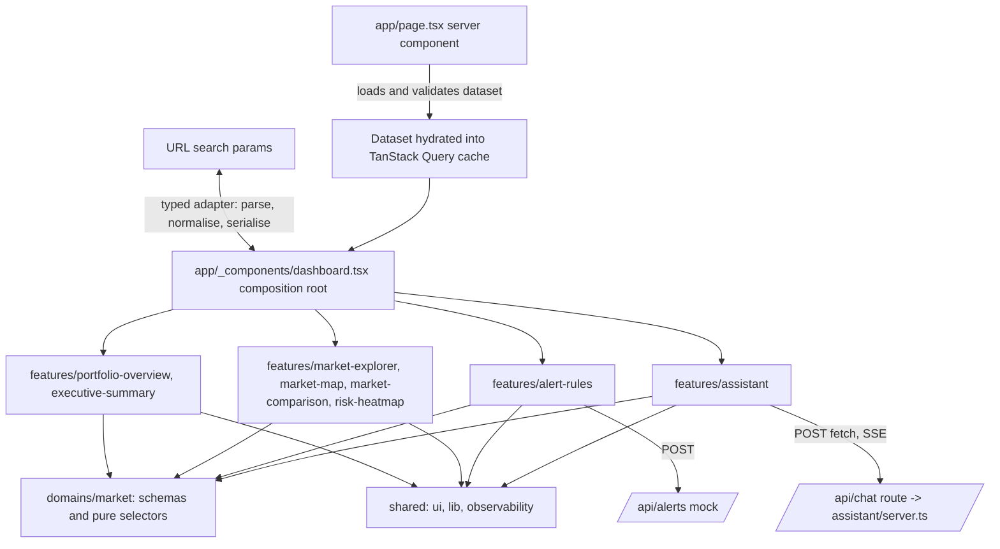

# Market Operations Console

A streaming, evidence-citing assistant next to an analytical dashboard, over a synthetic market-operations dataset (13 markets, 24 months, May 2026 latest). Next.js 16 App Router, React 19, strict TypeScript.

Video walkthrough (2.5 min): https://drive.google.com/file/d/19s3bm8LoqqksU7kkIQumU1AET4gTUIe1/view

Screenshots are in [`docs/screenshots/`](docs/screenshots) (1440 px and 390 px, both audiences, the assistant in its answer / streaming / abstain / error / evidence-drawer states, map, radar, heatmap, alert rules). They are regenerated with `SCREENSHOTS=1 pnpm e2e --grep "README screenshots"`.


## What is verified and what is not

| Capability | Implemented | Locally verified | Deployment verified | Planned |
|---|---|---|---|---|
| Streaming chat: Stop, retry, stale-event guard, partial/incomplete/error states | yes | unit + e2e (controlled streams) | `curl -N` on production shows token frames ~35 ms apart | resumable streams (needs a real backend) |
| Trust surface: confidence, abstain, citations, evidence drawer, AI-vs-dataset labelling | yes | unit + e2e + axe | root and API respond on production | sentence-level citations (the contract only has answer-level) |
| Dashboard: portfolio, explorer, executive/analyst modes, map, radar comparison, heatmap | yes | unit + e2e + axe | root 200 on production | virtualised table (13 rows do not need it) |
| Alert rules form with optimistic save and rollback | yes | unit + e2e | not exercised on production | server persistence |
| Error boundaries, allowlisted telemetry, CSP, security headers | yes | unit + e2e (CSP violations checked on a full journey) | headers are set by `next.config.ts`, not separately inspected on production | a real RUM vendor behind `/api/telemetry` |
| Performance | bundle budget, Lighthouse | `docs/performance.md` | not measured on production | field Core Web Vitals |
| CI | yes | green on `main` | n/a | preview-deploy smoke test in CI |

"Deployment verified" only covers what I actually ran against production: the root page returns 200 and `/api/chat` streams incrementally (checked through `vercel curl`). The Playwright suite runs against a local production build, not against the deployed URL.

**Deployment access:** the Vercel project has Vercel Authentication switched on, so anonymous visitors are asked to log in. I did not change that setting; it is an account security decision (Project → Settings → Deployment Protection).

## a. Quick setup

Requires Node 22 and pnpm 10.

```bash
pnpm install --frozen-lockfile
pnpm dev            # http://localhost:3000
pnpm check          # starter hashes, contrast, typecheck, lint, module boundaries, unit tests, production build
pnpm verify:server-only   # proves a client import of server code fails the build
pnpm e2e            # Playwright: builds, serves, runs desktop + mobile projects
pnpm bundle         # first-load JS size (writes docs/performance/bundle.json)
```

No environment variables are needed. `TELEMETRY_LOG=1` makes `/api/telemetry` log sanitised events to the server console.

State of the checks when this was written: 455 unit/component tests, 119 e2e passed (35 skipped by design: desktop-only or mobile-only variants), dependency-cruiser clean, typecheck and lint clean.

## b. Architecture overview



Layers, enforced by dependency-cruiser in `pnpm check` and CI (with fixture-based self-tests so the rules themselves are tested):

- `shared/` knows nothing about the business: UI primitives, formatting, telemetry.
- `domains/market/` is pure: Zod schemas, derived metrics (growth, forecast attainment, share), scope and view-state parsing, evidence resolution, alert evaluation. No React, no I/O.
- `features/*` are capabilities. A feature never imports another feature; each exposes a small public entry (`index.ts`, `client.ts`, `server.ts`).
- `app/` composes: it wires features to the URL and to each other through typed callbacks. A citation click in the assistant is turned into a URL change here; the assistant does not know the explorer exists.

**Server vs client state.**

| State | Owner | Why |
|---|---|---|
| Market dataset | Server component loads and validates it; hydrated into the TanStack Query cache | One fetch, one validated object, no per-chart fetching |
| Drill path, period, selected market, comparison set, audience mode | The URL | Shareable, reload-safe, back/forward works |
| Chat lifecycle (connecting, streaming, complete, stopped, incomplete, error) | `useReducer` in the assistant feature | Ephemeral, belongs to one surface |
| Alert rules | TanStack Query mutations (optimistic) over a mock endpoint, confirmed rules persisted to `localStorage` | The brief asks for an optimistic-save pattern with rollback |
| Form drafts | React Hook Form | Local to the form |

The chat route is the supplied starter route, adapted: input validation (400), abort-safe stream, fixture matching, and documented corrections to canned answers whose claims the data contradicts (see [`docs/data-quality.md`](docs/data-quality.md)). The original is kept untouched at `data/starter/reference/chat-route.ts`.

## c. Productionising it

Everything listed here exists in the repo.

- **Performance budget.** First-load JavaScript is measured by `pnpm bundle` and recorded in [`docs/performance.md`](docs/performance.md): 650.9 KB raw, 200.7 KB gzip, 174.5 KB brotli against an internal budget of 300 KB gzip. Analyst-only surfaces (heatmap, comparison, alert rules with the form library), the map with its geometry, and Recharts are lazy chunks, and the chart and the map are fetched only once scrolled near. Token updates are batched per animation frame so streaming does not re-render the dashboard per token.
- **Core Web Vitals.** Measured, not claimed: see "Measured" below. The `web-vitals` adapter reports CLS, INP, LCP, FCP and TTFB through the telemetry pipeline.
- **Observability.** `shared/observability` builds events from an allowlist of keys and code-shaped values, so free text (a question, an answer, an error message) cannot be sent even by mistake. Sources: assistant stream outcome (timings, retries, terminal state, classified error code), web-vitals, render errors. Sink: console in development, a beacon to `/api/telemetry` in production. That route re-applies the allowlist, stores nothing and always answers 204; it is the place a RUM vendor would plug in. Tests assert with sentinel strings that no question, answer or citation text leaves the app.
- **Resilience.** One error boundary per surface. Chart failures fall back to the same data as a table, with "Try again". A failed lazy chunk is retryable (`React.lazy` caches a rejection for good, so retry builds a fresh lazy component). The assistant keeps working when the map is down, and the reverse. The stream has bounded retry (max 2, 500 ms then 1 s plus jitter, honouring `Retry-After` within a 90 s budget), 15 s first-event and idle timeouts, and Stop cancels pending backoff.
- **Safely rendering model output.** Assistant text is rendered as text, never as HTML. Citations are validated against the dataset; an unknown id is shown as unresolved.
- **Hardening.** `next.config.ts` sets a same-origin CSP (`default-src 'self'`, `connect-src 'self'`, `object-src 'none'`, `frame-ancestors 'none'`, no third-party origin), nosniff, frame denial, referrer and permissions policies, COOP, and HSTS in production. Known limits: `script-src` needs `'unsafe-inline'` for Next's hydration scripts (a per-request nonce needs middleware and would make every page dynamic), and `'unsafe-eval'` is development-only. Zod runs in `jitless` mode so its eval probe does not trip the CSP.
- **Build, serve, cache.** `next build` with static assets served by Vercel's CDN under content-hashed paths; the page is a server component that renders the first view; `/api/chat` is a streaming route handler. The CSP and headers are applied to every route.
- **CI/CD.** `.github/workflows/ci.yml` runs install → `pnpm check` → server-only proof → Playwright. Vercel deploys every push to `main`.

### Measured

Lighthouse 12.8.2, headless Chrome on one Windows 11 desktop, against a local `next start` production build, simulated throttling, one run each:

| Preset | Perf | A11y | Best practices | SEO | FCP | LCP | TBT | CLS |
|---|---|---|---|---|---|---|---|---|
| Desktop | 100 | 100 | 100 | 100 | 0.3 s | 0.6 s | 0 ms | 0 |
| Mobile (4x CPU, slow 4G), 5 runs | 97 | 100 | 100 | 100 | 0.9 s | **2.52 s** median (2.44-2.57) | 70-90 ms | 0 |

The simulated-mobile LCP went from 4.2 s to about 2.5 s (five runs: 2.44 to 2.57 s, median 2.52 s; Lighthouse performance 81 to 97). What did it: the chart and the map download only when scrolled near, the assistant is a lazy chunk so the validation library is not in the first load, `web-vitals` and the Ctrl+K dialog load when idle, and the dataset travels in a compact form. That is at the 2.5 s target, not clearly under it, and these are lab numbers from one machine, not field data: I do not claim a Core Web Vitals pass. What I tried and reverted, and what I would try next, is in [`docs/performance.md`](docs/performance.md).

## d. Front-end approach and decisions

I have tested the edge cases of real AI products before, streaming most of all, so I built this chat the way I would build the real one, only against a mock backend. Most of my time went into the streaming part. The dashboard follows the same idea: every number has to be checkable.

**Framework: Next.js App Router.** I wanted one deployable thing: a server component that loads and validates the data, the streaming route right next to the UI, and Vercel to host it. I looked at Remix and TanStack Start. They would work too, but I would not get anything here that the App Router does not already give me. A plain Vite app was out because the chat needs a server route and I like having the first view rendered on the server.

**Design tokens, no component library.** Everything reads from CSS variables in `src/shared/styles/tokens.css` (Tailwind 4 on top). I skipped a component library because the screens here are very specific (a dense table, a heatmap grid, a drawer), and I would have spent the time overriding it. The price is that I own focus handling and the dialog behaviour, so those are the parts I test the most. A script (`pnpm verify:contrast`) calculates contrast from the real token values and fails the build if a pair gets too low ([`docs/design.md`](docs/design.md)).

**Streaming: my own transport, no SDK.** I use a plain `fetch` POST, `eventsource-parser`, a Zod schema for the three event types, and a reducer for the lifecycle. The protocol is tiny (`token`, `done`, `error`), and the hard parts are exactly what an SDK would hide from you: frames split across chunks, UTF-8 split across chunks, Stop, a late reply from an old request, retry, confidence and citations arriving only on `done`. I considered the Vercel AI SDK with a custom transport, but that adapter is the same work behind one more layer, and citations and confidence would turn into custom data parts. The OpenAI SDK is for calling a model, and there is none here. With a real model I would use the AI SDK. What I did: every attempt has an id and events from an older attempt are dropped, tokens are applied once per animation frame, and a reconnect inside the page is a new attempt, never a silent resume.

The conversation survives a refresh of the tab (`sessionStorage`, validated when read, last 50 messages). Finished answers come back as they were, and an answer that was still coming continues where it stopped: the client sends how many tokens it already has (`resumeFrom`) and the mock skips them. That is an extension of the supplied contract, and it only works because the mock is deterministic. A real model would need a buffer on the server with a cursor. A stopped answer is not resumed, and if something fails after a refresh you get the manual Retry.

**Making AI output trustworthy.** A citation is a pointer into the data, not a decoration: it opens a drawer with the exact figures and the supplied snapshot, says where they come from, and can set the whole dashboard to that market and month. Confidence is shown as text, an icon and a sentence about what it means for this answer, and only after `done`; after Stop it is marked unavailable. Low confidence and "I can't answer that" have their own wording and are not treated like errors. The assistant's text sits in its own purple panel labeled AI-generated; dashboard values say "Source: dataset" and never use the assistant's style. Five of the canned answers contradicted the data, so I wrote overrides and documented each one instead of bending the data ([`docs/data-quality.md`](docs/data-quality.md)).

**Data visualisation.** Recharts for the time series and the radar, `react-simple-maps` with world-atlas for the map (the geometry is copied into the feature and loaded lazily, no network call). The heatmap is a plain HTML grid, because it is 13 by 24 numbers and people should be able to move through it with the keyboard and read exact values. The radar normalises on purpose and shows the raw values next to it, and a missing value is never drawn as zero. Every chart comes with a text summary and a table with the same rows, and colour is always paired with text, an icon or a texture.

**State and URL.** TanStack Query for the dataset and the mutations, reducers for things that live on one screen, and no global store because nothing needed one. The URL is the only owner of the view: one typed adapter drops unknown ids, keeps the parts consistent, writes the URL the same way every time, pushes real selections to history and only replaces when it is cleaning up. Features get typed props and callbacks from `app/`, and never import each other.

**Forms.** React Hook Form with `zodResolver`, on the same Zod schema the server validates (`domains/market/alerts.ts`). The threshold has to be a real number (empty is an error, never 0) within bounds for its metric. The form shows which markets a rule would flag before you save. Saving is optimistic and rolls back when the mock server says no: any rule with "fail" in its name is rejected on purpose, and the UI says so. Rules are stored only in this browser (`localStorage`), because a global array on a serverless server would not survive.

## e. Accessibility (WCAG 2.1 AA)

Covered, with the test that checks it:

- Keyboard: roving tabindex in the heatmap grid and map table, arrow keys in the grid without swallowing browser shortcuts, a skip link, focus moved to the first invalid field, focus restored after "Try again" and after closing the drawer (e2e).
- Screen readers: landmarks and headings, `aria-sort` on sortable headers, one polite live announcement when an answer finishes rather than one per token, status and alert regions for save and error states (component + e2e).
- Modal assistant drawer on small screens: native `<dialog>` for evidence, `inert` page plus scroll lock, Escape closes the top layer only (e2e).
- Colour and contrast: token pairs checked by `pnpm verify:contrast` (4.5:1 text, 3:1 UI and focus); status is never colour alone (icon, text label, textures on the map); two-tone focus ring; forced-colors support.
- Charts: summary text and a data table for each chart, including the table fallback when a chart fails.
- Reduced motion: global CSS rule plus Recharts animation off; asserted for the radar polygon and the line, with a control run proving the probe can detect animation.
- axe-core runs in Playwright on the main views, with the assistant open, with errors showing, and on the 404 page.

Gaps: no manual screen-reader pass (NVDA/VoiceOver) — only automated axe and assertions on roles and names; no zoom-to-400% or text-spacing audit; light theme only; the map's country shapes are not individually navigable on touch beyond the table alternative.

## f. Testing

- **Unit (Vitest):** domain selectors (metrics, scope, view state, alert evaluation, rounding, comparison, heatmap), recomputed independently from the dataset where a number is asserted, the stream parser and reducer with chunk-boundary and UTF-8 splits, the telemetry allowlist, overrides recomputed from the data.
- **Component (Testing Library):** every feature, including failure paths (map/trend/radar throwing, lazy chunk rejecting), optimistic save and rollback, focus management.
- **End-to-end (Playwright, desktop and mobile):** the happy path, Stop, retry, abstain, error, stale attempts via controlled streams, URL round-trips, keyboard journeys, chunk failures, CSP violations on a full journey, telemetry content, axe on key views.
- **Architecture tests:** module boundaries with fixtures; server-only proof; starter files byte-checked against the supplied pack.
- **Skipped on purpose:** visual regression snapshots (screenshots are generated for review, not compared), cross-browser matrix (Chromium only), load testing, and tests against the deployed URL in CI.

## g. Key technical decisions

1. Own the stream transport instead of an SDK (section d).
2. URL as the only owner of view state; features never import each other.
3. Pure domain layer shared by the dashboard, the assistant overrides, the evidence drawer and the alert evaluation, so one number cannot differ between surfaces.
4. Derive growth and attainment from summed amounts for regions and the portfolio, never by averaging market percentages.
5. Show supplied statuses as supplied and label them, even where they disagree with derived attainment (Spain), instead of recomputing to make them agree.
6. Allowlisted telemetry that cannot carry free text.
7. Zod in `jitless` mode via a side-effect module imported first, found necessary by a CSP test and then re-measured so it did not cost bundle size.

## h. Engineering standards: followed and skipped

Followed: strict TypeScript (`noUncheckedIndexedAccess`, no `any`, no non-null assertions), typed contract end to end (dataset, SSE events, URL state, forms), enforced module boundaries, small public APIs, per-feature records in [`docs/engineering/features/`](docs/engineering/features), tests that were mutation-checked where they guard a bug, conventional commits, CI on every push.

Skipped or only partly done: no ADR folder (decisions are in the feature records), no Storybook, no bundle-size check in CI (the script exists, the gate does not), no dark theme, no i18n, no server persistence, Node 22 is required but pnpm scripts on my machine ran under Node 20.

## i. How I used AI tools

I used Claude Code for almost everything, and I tried to use it the way I would manage a junior who is fast but needs rules.

First I wrote the plan myself: phases from foundation to release, and for each phase what "done" means. Then Claude Code built it one phase at a time. Every phase went through the same gates before the next one started: typecheck, lint, module boundaries, unit tests, build, end-to-end tests, a look at the running app in a real browser, and then one independent reviewer agent that only reads and gives a verdict. Most phases failed that first review, and the defects were fixed before moving on. The list is in `docs/engineering/features/` and `docs/engineering/STATUS.md`. The rules for the agent are written in `AGENTS.md` and `docs/engineering/`, so the standard lives in the repo and not in my head.

Do's: write the plan and the acceptance criteria first, keep the rules in files, make the agent show evidence (test output, a screenshot, a number) and not just say it is done, use a separate reviewer.
Don'ts: let the agent weaken a test to get green, let several agents write code in parallel, add extras before the required work is committed, trust a number it wrote in a test without recomputing it.

Where I did not trust the output: the canned assistant answers (five of them contradicted the data, and I corrected them with a documented override), the numbers in tests (recomputed independently), and flaky tests (I looked for the cause instead of re-running until green; one was a stream left running into the next test).

## j. What I would do with more time

- Get the mobile LCP clearly under 2.5 s: take TanStack Query off the first-load path, split the executive and analyst compositions into separate chunks, and measure on the deployed site with real brotli.
- Real RUM behind `/api/telemetry` and error tracking with source maps; field Core Web Vitals instead of lab numbers.
- A manual screen-reader pass and a 400% zoom audit; a dark theme.
- Run the Playwright happy path and a Stop test against each preview deployment in CI; add the bundle budget as a CI gate.
- Server persistence for alert rules and a real notification path.
- Sentence-level citations if the contract grows to carry them; resumable streams with a real backend.
- Storybook stories for the core components (the one stretch goal I did not build).

## Stretch goals built

All four are covered by unit tests and by [`tests/e2e/stretch.spec.ts`](tests/e2e/stretch.spec.ts).

- **Assistant aware of the view.** The dashboard sends what it is showing (market, region, product, month) with each question; the panel states it ("Asking about Germany · Mar 2026") and offers questions about it. "What am I looking at?" and "how is this market doing?" are answered from the dataset for exactly that view, with the matching citation. Context only fills in for words like *this* or *here*: a place named in the question wins, and unknown ids in the context are ignored by the server (`features/assistant/lookup.ts`).
- **Command palette (Ctrl/Cmd+K).** Jump to the portfolio, any region, any market or any product in a market. A modal dialog with a combobox (arrow keys, Enter, Escape, focus returns to where it was); the search is pure and tested (`features/command-palette`).
- **Virtualised dense table.** The analyst view lists all 1,560 monthly facts for the current scope, sortable, with only the visible rows plus a few either side in the page. Spacer rows keep the scrollbar honest and rows carry `aria-rowindex` and the table `aria-rowcount`, so a screen reader still hears "row 812 of 1,561". The windowing maths is a pure function (`features/fact-table/model/window.ts`). No library: for fixed-height rows a window calculation is a few lines, and I wanted to own the accessibility.
- **Live mode.** A switch starts a simulated feed: every 2.5 s the latest month's actuals and units move by a bounded random walk (+-3% of the supplied value, deterministic, `domains/market/live.ts`). Changed figures flash (not with reduced motion), and the selection, URL, sort order and scroll positions are untouched because the data is the only thing that changes. The assistant and its evidence deliberately keep using the supplied dataset, and the switch says so: the point of the evidence drawer is that it shows source data. Forecasts, prior-year values, earlier months and the supplied status snapshot are never simulated.

## k. A note on the writing

What I wanted to show here is that I know what breaks in AI interfaces. The backend is a mock, but I tried to cover most of the real streaming edge cases anyway: retries, stop, a stream that dies in the middle, a stale reply from an old request, a page refresh while an answer is still coming, malformed events. One I know how to cover but could not honestly build here is several chat sessions open at once (two tabs, or a phone and a laptop). With a mock there is no server state to disagree about, so I would only be guessing, and I would rather leave it out and say so.

I really wanted to connect a real LLM. I have a lot of experience with that, and it would have let me improve the quality of the answers and play with the hard parts (long answers, tool calls, resuming a stream for real). The assignment says the intelligence should be faked, so I kept to that and spent the time on the surface instead.

Honestly, it was fun.

## Attributions

Country geometry: [world-atlas](https://github.com/topojson/world-atlas) (Natural Earth, public domain). Starter data, fixtures, contract and reference route: the supplied starter pack, kept byte-identical in `data/starter/`.
