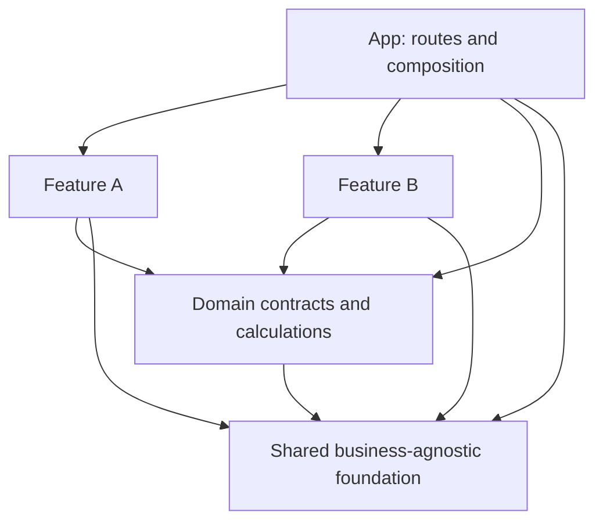

# Загальна архітектура для AI-assisted development

> Starter baseline correction (2026-11-03): build on the supplied starter, verified identical to the email ZIP. Read STARTER-BASELINE.md in the planning package (or docs/engineering/STARTER-BASELINE.md in agent-kit). F00 must preserve/import the supplied assets and connect/smoke-test reference/chat-route.ts with fixtures.json; F03 adds the chat surface and hardens that existing route. This explicit reuse requirement takes precedence over older wording about a shell-only foundation or a greenfield build.

Статус: погоджуваний робочий стандарт, сформований за запитом Антона. Це правила для майбутнього репозиторію; foundation застосунку та CI ще не реалізовані.

## Модель

**Feature-agnostic foundation + feature-oriented delivery.** Infrastructure не знає про конкретні бізнес-фічі. Кожна фіча додається як завершена capability із власними межами й окремою історією змін. Застосунок має один deployable artifact і явні внутрішні модулі.



Feature A і Feature B не імпортують одна одну. Їх зв'язок збирається в composition root через callback/props; domain layer визначає спільні бізнес-поняття.

## Структура, яку вводимо поступово

```text
AGENTS.md
.agents/skills/feature-delivery/SKILL.md
docs/
  engineering/           # правила процесу, status, feature specs
  decisions/             # короткі ADR, коли рішення справді потрібні
src/
  app/                   # framework routes, providers, composition
  shared/
    ui/                  # Button, Dialog, Field, typography
    lib/                 # бізнес-незалежні helpers із реальним consumer
    config/              # runtime/env schema, коли потрібна
  domains/
    <domain>/            # pure schemas, types, calculations, tests
      index.ts           # public domain API
  features/
    <capability>/
      index.ts           # public types, без mixed runtime exports
      client.ts          # client UI entry, коли потрібний
      server.ts          # server-only entry, коли потрібний
      ui/
      model/
      api/
      tests/
tests/e2e/               # journeys між фічами
```

Дерево — орієнтир, не команда створити всі порожні папки. У F00 достатньо shell, кількох UI primitives, toolchain, перевірки меж і одного runnable smoke. Domain schema вводиться з першою бізнес-capability; SSE parser — разом із streaming assistant. Не створювати наперед всі схеми, services та abstractions для майбутніх фіч.

`domains` містить бізнес-специфіку, тому не називаємо його feature-agnostic infrastructure. Domain calculation може бути спільним для кількох фіч відразу, якщо це один реальний invariant, наприклад формула forecast attainment.

## Дозволені залежності

| Звідки | Куди дозволено | Заборонено |
|---|---|---|
| shared | shared, external packages відповідного runtime | domains, features, app |
| domains | власні internals, shared pure helpers, validation libraries | React/UI, browser APIs, Next runtime, I/O, features, app |
| feature A | власні internals, public domain API, public shared modules | feature B, app, чужі internals |
| app | public feature/domain/shared API, власна composition | deep imports у private feature implementation |
| cross-feature E2E | UI/HTTP public behavior | залежність тесту від private hooks та internal store |

Для цього проєкту достатньо одного домену market. Якщо згодом з'являється кілька domain modules, їх залежності мають бути явними й ациклічними; mutual imports — сигнал змінити межі.

Private relative imports дозволені всередині одного модуля. Публічний API має бути маленьким; `export *` у root barrel не є автоматичним дозволом відкрити весь модуль. Public entry може бути `shared/ui/button`, не обов'язково один гігантський `shared/index.ts`.

## Composition і state ownership

- App composition з'єднує features і URL adapter. Це місце wiring, не business god object.
- Remote data/cache мають визначеного owner. Для спільного market dataset provider/loader живе на app composition рівні, features отримують typed dataset/view models. Немає дубльованих fetch у кожному chart.
- Domain calculations — pure; не читають URL, React context або storage.
- Feature ephemeral state — локально: chat reducer, form draft, open evidence drawer.
- URL зберігає shareable selection/filter/mode, а не дублюється незалежно в global store.
- Feature-specific adapter, наприклад alert save, залишається всередині alerts.
- Server dataset loader може жити в `app/_server`; browser features отримують serializable data. Feature server handlers викликаються через thin `app/api/.../route.ts`.

Приклад інтеграції: assistant викликає `onOpenEvidence(target)`. App переводить domain evidence target у валідований URL selection. Market explorer отримує нову selection. Assistant не імпортує explorer і не мутує його store.

Усі runtime paths мають явну сторону: feature `server.ts` позначений server-only; client entry не експортує server code. Type-only exports можна ділити між сторонами. CI має ловити не тільки TypeScript imports, а й runtime graph/cycles.

## Перевірки меж у F00

Виконавець обирає сумісний із toolchain linter/dependency analyzer, налаштовує його і доводить ці сценарії на temporary fixtures:

1. Shared → feature import падає.
2. Domain → React/browser/framework import падає.
3. Feature A → feature B падає, включно з relative alias bypass та re-export.
4. App → feature private file падає; app → public entry проходить.
5. Module cycle падає; allowlisted framework/runtime imports проходять.
6. Client entry → server-only runtime code не проходить build.

Checks повинні враховувати aliases, resolved paths, re-exports і dynamic imports із статичним шляхом. Неконтрольований computed module path не використовувати для обходу правил. Прості regex перевірки — недостатній доказ dependency graph.

До встановлення та запуску analyzer ці правила є policy. F00 включає actual implementation і CI wiring; docs-only validation не замінює цю роботу.

## Як архітектура еволюціонує

1. Друга незалежна feature потребує вже наявної бізнес-функції → винести її у domain public API з regression tests.
2. UI primitive має два реальні consumers → розглянути shared; однаковий вигляд без однакової семантики не вимагає abstraction.
3. Змінився public contract → короткий ADR, усі consumers оновити в одному buildable change або додати тимчасову сумісну версію з removal task.
4. Технічне покращення не належить поточній feature → окремий refactor commit/task, якщо воно необхідне; інакше backlog.
5. Видалення feature прибирає її папку та app wiring; shared/domain не мають починати імпортувати видалену capability.

Ніяких універсальних repositories, plugin registries, dependency injection frameworks або global buses лише для демонстрації архітектури. Додавати їх тільки під конкретну вимогу, яку простіша композиція не задовольняє.
