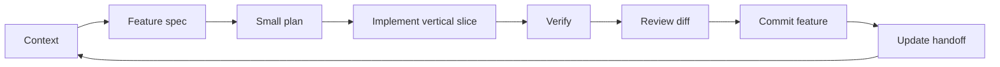

# Development lifecycle та Git workflow

> Starter baseline correction (2026-11-03): build on the supplied starter, verified identical to the email ZIP. Read STARTER-BASELINE.md in the planning package (or docs/engineering/STARTER-BASELINE.md in agent-kit). F00 must preserve/import the supplied assets and connect/smoke-test reference/chat-route.ts with fixtures.json; F03 adds the chat surface and hardens that existing route. This explicit reuse requirement takes precedence over older wording about a shell-only foundation or a greenfield build.

## Один повторюваний цикл



Ці gates перевіряє агент сам. Вони не означають запит дозволу після кожного кроку. Якщо поточна авторизація покриває роботу, агент рухається далі; уточнення потрібне лише для справді невідомого рішення, що суттєво змінює результат.

## 0. Foundation

F00 — runnable shell, toolchain, tokens, module rules, automated boundary checks, мінімальний CI, один startup smoke. Foundation може мати окремий docs commit та scaffold commit; обидва обмежені infrastructure scope.

Foundation не містить заготовок усіх майбутніх services, mocks, schemas або features. Вихідний продукт уже запускається, але бізнес-capabilities приходять наступними delivery units.

## 1. Context та Definition of Ready

Перед feature прочитати актуальні repo instructions, STATUS, специфікацію та потрібні source contracts. Подивитися current branch, uncommitted changes, останні commits і наявні public APIs. Не покладатися на пам'ять попереднього агента.

Feature готова до реалізації, коли зрозуміло:

- Яку дію/результат отримає користувач.
- Які acceptance examples доводять цей результат.
- Що входить і не входить у scope.
- Які dependencies вже існують, хто володіє файлами/станом.
- Який public contract додається і як перевірити failure case.

Короткий запис за template — достатній. Для дрібного fix вистачає стислого опису regression/verification у поточній feature record; не створювати пакет із десятків порожніх документів.

## 2. Plan → implementation

План на одну feature зазвичай 3–7 кроків. Перед змінами зафіксувати expected commit scope. Implement observable vertical slice: schema/logic, необхідний adapter, UI, integration, tests. Не робити весь domain для всього roadmap, потім весь UI, потім усі тести.

Acceptance criteria вважаються unmet, поки не є evidence. Для parsing, aggregation, URL normalization, optimistic rollback, async cancellation та bug fixes: focused failing example → implementation → green → refactor. Для reversible styling: visual verification замість штучних unit tests.

Стан loading/empty/error/partial додається разом із capability, коли релевантний. Accessibility входить у UI acceptance. Global redesign або unrelated dependency upgrade не включати мовчки.

## 3. Verification gates

| Gate | Коли | Evidence |
|---|---|---|
| Diff scope | кожен commit | перелік файлів та відповідність feature |
| Typecheck/lint/boundaries | feature code changes | фактичний command result |
| Focused tests | behavior/data/async changes | assertions на acceptance/failure examples |
| Browser check | UI interaction/layout | відтворений user path, viewport, a11y notes |
| Build | завершення feature, що змінює executable app | production build result |
| E2E regression | зміна cross-feature path, routing, streaming або завершення milestone | affected journey проходить |
| Full required suite | integration/release boundary | CI або еквівалентний локальний run |

Для docs-only change перевірити точність і links, не запускати весь browser suite. Якщо немає змін після успішних перевірок, не повторювати їх без причини. Локально проходить ≠ CI пройшов ≠ deployed app перевірений: у звіті називати реальний рівень.

Якщо check не може виконатися, агент записує причину й завершує незалежну роботу. Feature лишається verified-partially/blocked за фактичним станом; не вважати skipped test pass. Не послаблювати assert, lint rule або acceptance criterion лише для зеленого результату.

## 4. Review → commit

Review охоплює весь diff і потрібних consumers. Порядок: відповідність scope → correctness/data → state/async → dependencies/runtime → UX/accessibility → tests. Виправити реальні дефекти до позначки done. Independent reviewer корисний для складної feature, якщо делегація дозволена; інакше explicit self-review достатній.

Один commit — одна зрозуміла причина зміни. Зазвичай feature поміщається в один завершений commit; велика feature може мати кілька coherent/buildable commits. Не потрібно штучно ховати всю історію в squash або навпаки комітити кожен файл окремо.

Приклади convention для цього repo:

```text
docs(engineering): define architecture and feature delivery rules
chore(foundation): add runnable shell and boundary checks
feat(portfolio): show verified portfolio health and market table
feat(explorer): add shareable market and product navigation
feat(assistant): stream answers with stop and evidence navigation
feat(map): drill into markets from the choropleth
fix(assistant): preserve partial response after stream interruption
refactor(market): centralize aggregation used by overview and comparison
```

Це приклади майбутніх messages, не виконані commits. Scope описує capability. Новий feature commit включає її tests, інтеграцію та короткі docs; окремий test commit доречний для самостійного покращення coverage, а не як відкладена якість усіх фіч.

Перед commit: inspect Git status → stage only owned paths/hunks → inspect staged diff → commit → verify actual commit/status. Не включати випадкові outputs, secrets або сторонні user edits. Якщо Git repo/identity відсутні, налаштування виконати за відомим project context; не вигадувати ім'я/email.

Default: послідовні feature commits на наявній task branch. Feature branches/PRs додаються, якщо це workflow repo або окремо потрібно. Ні нова worktree для кожної дрібниці, ні force-push не є частиною базового циклу.

## 5. Definition of Done та resume

Feature done означає:

- Acceptance criteria виконані й видно працюючий результат.
- Інтеграція з уже наявними features не зламана.
- Public contracts, module boundaries і runtime ownership дотримані.
- Релевантні tests/visual checks/build пройдені; є evidence.
- Реальні review findings виправлені; limitations названі.
- Feature має власний Git commit або послідовність commits.
- STATUS містить наступний крок, а не абстрактне «continue».

Feature record може містити verification evidence до commit. Actual SHA додати в STATUS наступним metadata update або next feature commit; не amend-ити commit нескінченно, щоб записати його власний SHA. Uncommitted status-only update вказати явно, якщо він залишився.

Нова сесія читає STATUS і перевіряє його за Git. Якщо interrupted feature лишила diff, спочатку оцінює й завершує його; не стартує новий scaffold. Перед наступною feature агент повідомляє коротко: outcome, checks, commit, next feature.

## Делегація

Default — sequential delivery одним агентом. Якщо Антон дозволить subagents, coordinator може делегувати перевірку або незалежний work package після визначення контрактів. Один owner на shared contracts/package manifest, жодного паралельного редагування того самого файла. Worker повертає changed paths, tests, assumptions, issues; coordinator інтегрує та перевіряє результат. Сам факт наявності skills не є наказом spawn-ити агентів.
